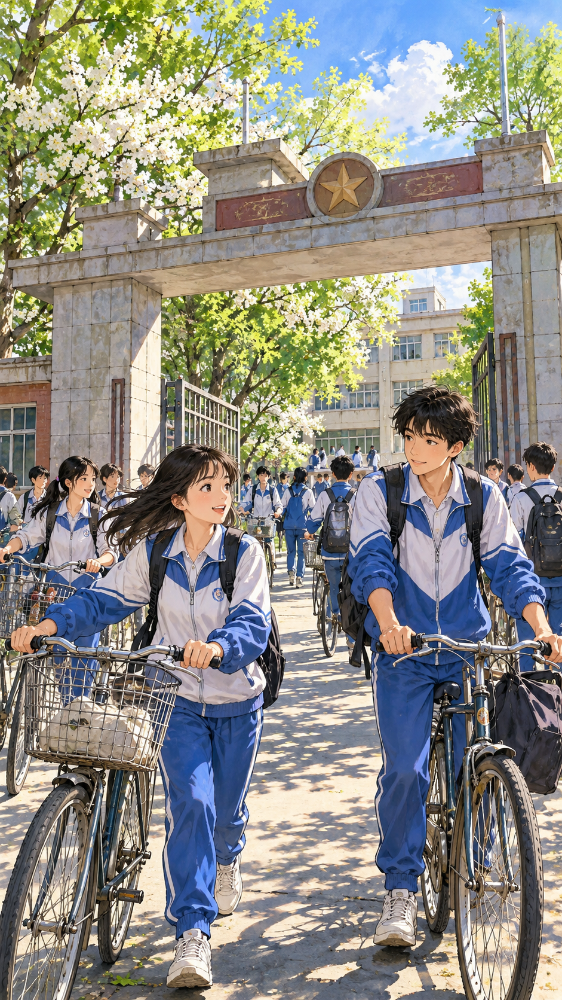
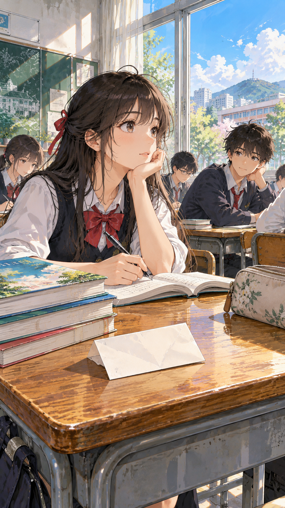
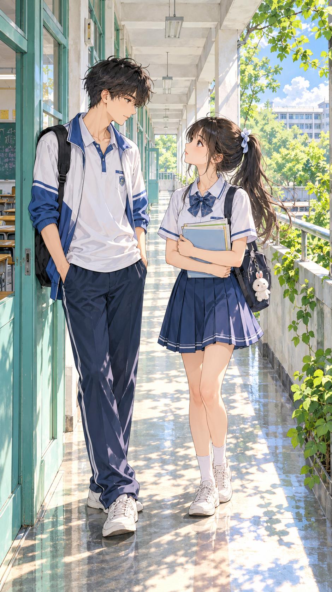
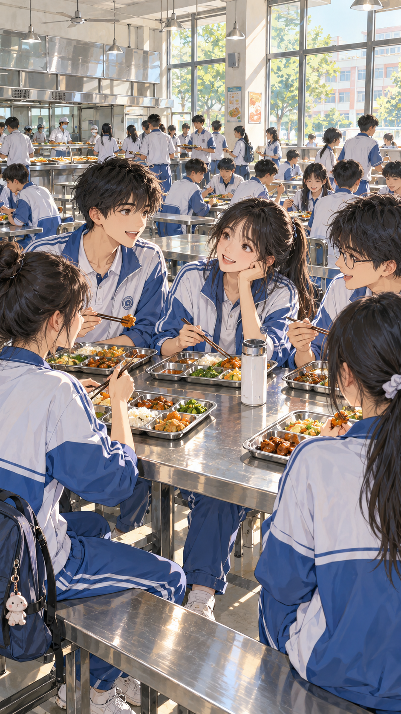
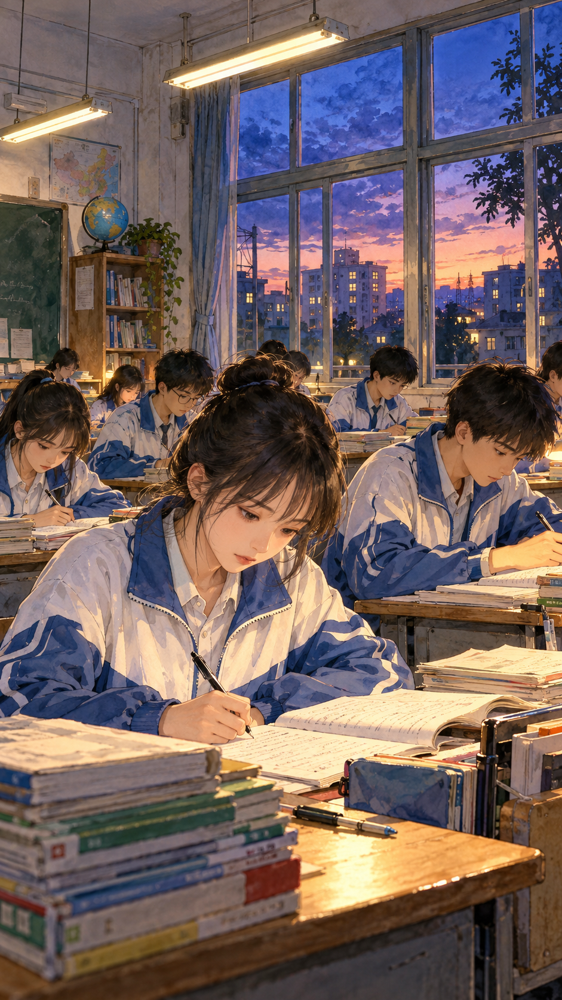

# 第一期｜高中校园漫画场景提示词

五个场景来自平行时空现有插画。以下为根据素材重新提炼的复刻提示词，尚未逐条重新生成验证。

## 通用设定

2000年代普通中学，初夏，蓝白运动校服。手绘漫画背景质感，人物比例自然。保持人物发型、校服、建筑与参考图一致。镜头、主体动作、光线与配色按下方场景设定。手机竖屏构图，中下部留低细节区域。不含可辨认文字、品牌、水印、按钮或界面。

## 校门重逢



```text
2000年代普通中学，初夏，蓝白运动校服。手绘漫画背景质感，人物比例自然。保持人物发型、校服、建筑与参考图一致。镜头、主体动作、光线与配色按下方场景设定。手机竖屏构图，中下部留低细节区域。不含可辨认文字、品牌、水印、按钮或界面。
初夏的普通中学校门，蓝白校服学生推自行车进入校园。平视中远景，校门和树冠构成画框。柔和晨光、树叶绿与天空蓝，底部道路留旁白区域。
```

## 课桌纸条



```text
2000年代普通中学，初夏，蓝白运动校服。手绘漫画背景质感，人物比例自然。保持人物发型、校服、建筑与参考图一致。镜头、主体动作、光线与配色按下方场景设定。手机竖屏构图，中下部留低细节区域。不含可辨认文字、品牌、水印、按钮或界面。
从课桌斜上方看空白纸条、课本与笔，窗边同学在中景。午后侧光、木色与米白，纸条无文字，右下桌面留白。
```

## 课间走廊



```text
2000年代普通中学，初夏，蓝白运动校服。手绘漫画背景质感，人物比例自然。保持人物发型、校服、建筑与参考图一致。镜头、主体动作、光线与配色按下方场景设定。手机竖屏构图，中下部留低细节区域。不含可辨认文字、品牌、水印、按钮或界面。
教学楼长走廊，两位同学在窗边交谈，蓝白校服。平视中景，柱廊形成纵深。左侧柔和日光，底部减少碎光与纹理。
```

## 食堂晚饭



```text
2000年代普通中学，初夏，蓝白运动校服。手绘漫画背景质感，人物比例自然。保持人物发型、校服、建筑与参考图一致。镜头、主体动作、光线与配色按下方场景设定。手机竖屏构图，中下部留低细节区域。不含可辨认文字、品牌、水印、按钮或界面。
校园食堂的长桌旁，同学一起吃饭聊天。餐盘、水杯与窗户交代日常，中景平视。背景人群简化，暖光照到桌面，底部留连续色块。
```

## 晚自习



```text
2000年代普通中学，初夏，蓝白运动校服。手绘漫画背景质感，人物比例自然。保持人物发型、校服、建筑与参考图一致。镜头、主体动作、光线与配色按下方场景设定。手机竖屏构图，中下部留低细节区域。不含可辨认文字、品牌、水印、按钮或界面。
蓝紫暮色窗外与暖白室内灯光，两位同学看同一道题。中近景，课本与笔在桌面，统一校服和窗框。文字区避开灯管与反光。
```

## 继续创作

提示词获取与整理可关注 humeng 小程序。官网提示词入口 https://itlifetime.com/prompts 。
## 用 Skill 扩展这组风格

调用 [ui-scene-prompt-skill](../../skills/ui-scene-prompt-skill/SKILL.md)，输入新的年代、校服、季节和场景。技能按校园主题规则重新生成完整提示词，保持镜头变化与风格连续。五个单条文件和本页合集同步保存。
